<p align="center">
  <picture>
    <source media="(max-width: 600px) and (prefers-color-scheme: light)" srcset=".github/assets/banner-phone-light.svg">
    <source media="(max-width: 600px)" srcset=".github/assets/banner-phone.svg">
    <source media="(prefers-color-scheme: light)" srcset=".github/assets/banner-light.svg">
    
  </picture>
</p>

<div align="center">

[](https://github.com/ryanduguid/au-accounting-hotkeys/actions/workflows/check.yml)
[](https://scorecard.dev/viewer/?uri=github.com/ryanduguid/au-accounting-hotkeys)
[](https://www.autohotkey.com/)
[](LICENSE)

</div>

Type Australian workpaper dates and use a searchable library of period labels, draft snippets and text transformations on Windows with AutoHotkey v2.

## Start

1. Install [AutoHotkey v2](https://www.autohotkey.com/) on Windows.
2. Download this repository using **Code**, then **Download ZIP**, and extract it.
3. Double-click `accounting-hotkeys.ahk`.
4. Open a blank text document and press **Insert**. It types `30/06/2026`.

The first run copies `config.example.ini` to `config.ini`. The default shortcuts work in all applications while the script runs, and Insert replaces the key's usual action. Check the selected year and quarter before using them in a workpaper.

Right-click the AutoHotkey tray icon and select **Suspend Hotkeys** to suspend the shortcuts, or **Exit** to stop the script. The script starts only when you run it.

## Default shortcuts

| Shortcut | Types | Example settings |
| --- | --- | --- |
| Insert | Selected financial-year end | `30/06/2026` |
| Ctrl + Alt + D | Today's date in `dd/MM/yyyy` format | Uses the computer's local date |
| Ctrl + Alt + Q | Selected quarter end | `30/06/2026` for Q4 |
| Ctrl + Alt + Y | Selected financial-year label | `2025-26` |

Dates and labels assume a 30 June financial-year end. They are period labels, not lodgement deadlines. The selected year stays fixed until you change it, so earlier workpapers retain their chosen dates.

## Enable the command picker

Open settings from the tray menu and add this under `[Hotkeys]`:

```ini
Picker=^!Space
```

Save and select **Reload Script**. Press **Ctrl + Alt + Space** in an allowed application. `Picker` is disabled by default so the original four shortcuts work without enabling clipboard actions.

1. Search by command name, category, identifier or snippet text, for example `quarter end`, `ABN` or `bank`. All words must match, ignoring case. Snippet text is searched before date tokens are expanded.
2. Select a command with the arrow keys or mouse. Generated dates and snippets show a preview immediately.
3. For an input command, type into **Input text** or choose **Load clipboard and preview**. Opening and searching the picker do not read the clipboard.
4. Review the preview, then choose **Copy result**. Copy uses that exact result, even if the clipboard changes afterwards.
5. Paste into the intended destination yourself. Copy replaces the clipboard; the picker does not type into another window.

Use Tab to move between controls and Escape to close. Changing commands clears the previous input. The four typing shortcuts are suppressed while the picker or one of its dialogs is active.

Output whose cells begin with `=`, `+`, `-` or `@` triggers a confirmation before copying. This is a warning, not a guarantee about spreadsheet interpretation. Format destination cells as Text when dates or leading-zero identifiers must remain exact. Clipboard history, synchronisation and remote-desktop policies may retain copied text; follow your firm's policy.

## Command library

The picker includes 59 built-in commands and 12 draft snippets:

- Copy financial-year and quarter starts, ends, ranges, ISO dates and filename labels.
- List the selected year's month ends.
- Convert one explicit Australian, ISO or compact date, find its month boundaries or its financial year and quarter, or count the days between two dates.
- Clean, format and total pasted amounts, and work out 10% GST on GST-inclusive or GST-exclusive amounts.
- Format ABNs and ACNs without losing leading zeros, and report their format/checksum result.
- Trim, normalise, number, sort and deduplicate text, or turn lines into a CSV row, a tab-separated row or a quoted list.
- Prepare a filename component as text, without renaming a file.
- Start records requests, reconciliation workpapers, journal support notes and review queries from editable drafts.

See the [command catalogue](docs/commands.md) for every command, input rule and example. [Sources and related projects](docs/resources.md) records the inspected repositories, licences and official references.

ABN and ACN reports do not check registration, identity, active status or GST registration. GST commands assume each line is wholly taxable at 10%; they do not decide whether a supply is taxable, GST-free or input taxed. The snippets contain fields to complete and do not establish that a procedure has been performed or a conclusion reached.

## Configure

Select **Open settings** from the tray menu, or edit `config.ini` directly:

```ini
[Period]
FinancialYearEnding=2026
Quarter=4

[Scope]
Applications=

[Hotkeys]
YearEnd=Insert
Today=^!d
QuarterEnd=^!q
FinancialYear=^!y
Picker=
```

Save the file and select **Reload Script** from the tray menu. The tray tooltip shows the selected financial year and quarter.

`FinancialYearEnding` accepts a four-digit year from 1900 to 9999. For a year ending in 2026:

| Quarter | End date |
| --- | --- |
| 1 | `30/09/2025` |
| 2 | `31/12/2025` |
| 3 | `31/03/2026` |
| 4 | `30/06/2026` |

Leave `Applications` blank for all applications. To enable shortcuts only in Excel and Word, set:

```ini
[Scope]
Applications=EXCEL.EXE,WINWORD.EXE
```

Hotkeys accept a single named key, such as `Insert` or `F6`, with optional modifiers: `^` for Ctrl, `!` for Alt, `+` for Shift and `#` for Windows. For example, `YearEnd=^!e` uses Ctrl + Alt + E. Leave a hotkey value blank to disable that command. Duplicate mappings, unknown hotkey commands and invalid settings stop startup with an error message. The five recognised hotkey keys are `YearEnd`, `Today`, `QuarterEnd`, `FinancialYear` and `Picker`; additional commands are available through the picker.

`config.ini` is ignored by Git so your settings remain local. Keyboard layouts and application shortcuts can differ; test your mappings in the applications you use.

Configuration examples: [Excel and Word](examples/excel-word.ini), or [picker only with a historical period](examples/picker-only.ini). Copy the chosen example to `config.ini` after reviewing its scope and mappings. See [troubleshooting](docs/troubleshooting.md) if shortcuts do not respond.

## Customise snippets

Bundled drafts live in `snippets`. To keep your own wording local, create a `snippets.local` directory beside the script and put UTF-8 `.txt` files in it. Start with [Custom-snippet.txt](examples/Custom-snippet.txt). Filenames become labels and must start with an ASCII letter or digit. Remaining characters may be ASCII letters, digits, spaces, underscores or hyphens, with at most 80 characters in total. Labels are compared case-insensitively; use a unique label across both folders.

The picker takes a fresh snapshot when it opens. It loads only top-level text files, rejects Windows reparse points such as symbolic links and junctions, and never writes to snippets. NTFS hard links are not detected. Invalid files are excluded with a visible explanation, while the original shortcuts remain available.

Supported date tokens are `{{TODAY_AU}}`, `{{TODAY_ISO}}`, `{{FILE_DATE}}`, `{{FY_START}}`, `{{FY_END}}`, `{{FY_LABEL}}`, `{{FY_RANGE}}`, `{{Q_START}}`, `{{Q_END}}`, `{{Q_RANGE}}` and `{{Q_NUMBER}}`. Token names are case sensitive. Unknown or incomplete tokens are errors; replacement happens once. AutoHotkey-looking text stays text.

Each snippet accepts up to 16,384 characters and 100 tokens. A folder containing more than 100 text files is excluded; the library considers at most 100 files across both folders, with at most 262,144 characters of accepted snippet text. General input and output accept up to 32,768 characters; dates and identifiers accept up to 64. These counts use UTF-16 code units. Oversize results are rejected without truncation. See the catalogue for command-specific limits.

Clipboard size is validated after Windows supplies the text. The limit bounds accepted processing and output, but not the clipboard provider's initial allocation or transfer.

## Use the date helpers in another script

Include `dates.ahk` to use its functions without registering hotkeys:

```ahk
#Requires AutoHotkey v2.0
#Include C:\path\to\au-accounting-hotkeys\dates.ahk

MsgBox(FinancialYearEnd(2026))       ; 30/06/2026
MsgBox(QuarterEnd(2026, 1))          ; 30/09/2025
MsgBox(FinancialYearLabel(2026))     ; 2025-26
MsgBox(AustralianDate())            ; Today's local date
```

Related tools: [Accounting Excel Toolkit](https://github.com/ryanduguid/accounting-review-pipeline/tree/main/adapters/accounting-excel-toolkit) provides Power Query and VBA utilities; [Ozzit](https://github.com/ryanduguid/Ozzit) provides native Excel modelling functions.

See [library helpers](docs/library.md) for the additional date, identifier, text and snippet APIs. Helpers can be included without starting shortcuts or reading the clipboard.

## Check changes

From the repository root, run these PowerShell commands with AutoHotkey v2 installed:

```powershell
& .\tests\run.ps1
& .\tests\run.ps1 -UI
```

For a portable or differently located runtime, pass `-AutoHotkey 'C:\path\to\AutoHotkey64.exe'`.

The first command checks date boundaries, identifier algorithms, configuration, text transformations, snippet loading, limits and picker state using a fake clipboard. It also checks production boundaries against positive controls. The second opens fabricated windows, types through all four shortcuts, operates the native picker controls and checks application scope. It requires an interactive Windows desktop and closes its test windows afterwards. Neither command reads or writes your clipboard.

GitHub Actions runs the first command with checksum-verified AutoHotkey 2.0.30 runtimes for x64 and x86. The interactive checks must be run locally. These checks do not establish compatibility with individual accounting applications, Excel cell interpretation, alternate keyboard layouts, remote desktops or firm clipboard policies.

CodeQL and zizmor check the GitHub Actions workflows. Tagged releases run the library and workflow security checks before packaging the source with signed build provenance. See [security checks and release verification](docs/security.md) for their coverage, release requirements and download verification commands.

## Contribute

See [CONTRIBUTING.md](CONTRIBUTING.md) for the checks and information to include with a change.

Licensed under the Functional Source License, Version 1.1, ALv2 Future License (FSL-1.1-ALv2). You may use, modify and redistribute it for any purpose except a Competing Use as defined in LICENSE (making it available to others in a competing commercial product or service), and each version becomes available under Apache-2.0 two years after it is made available. See [LICENSE](LICENSE) and [NOTICE](NOTICE). If you redistribute this work or build on it, keep the copyright notices in [NOTICE](NOTICE).

---

<p align="center"><sub><kbd>F</kbd> to pay respects is not bound by default.<br>Made in Newcastle, Australia by <a href="https://duguid.com.au/">Ryan Duguid</a>.</sub></p>
